&#x20;\

# Hi, I'm Amr Tamer 👋

### Backend Developer | C# & .NET Specialist

Building scalable applications, designing databases, and turning ideas into practical software solutions.

\

\

---

## 👨‍💻 About Me

- 💻 Backend Developer specializing in **C# and .NET**.
- 🚀 Interested in building reliable and maintainable software applications.
- 🗄️ Experienced in database design, SQL Server, and Entity Framework.
- 🏗️ Interested in software architecture, OOP, and clean code principles.
- 📚 Continuously learning and improving my problem-solving skills.
- 📍 Based in Cairo, Egypt.

---

## 🛠️ Tech Stack

### Backend Development

\
   \ \

### Databases

\

&#x20; \
\

### Programming Languages

\

&#x20; \
\

### Tools & Technologies

\

&#x20; \
\

---

## 🚀 Featured Projects

### 🚗 DVLD - Driving & Vehicle Licenses Department

A comprehensive desktop application for managing driving license services.

- C# & Windows Forms
- Microsoft SQL Server
- 3-Tier Architecture
- Database Design & Management

### 🔧 Maintenance & Repairs Management System

A web-based system for managing maintenance requests and technician workflows.

- ASP.NET Core MVC
- Entity Framework Core
- SQL Server
- Authentication & Role-Based Authorization

### 🏦 Bank Management System

A console-based banking application for managing clients and financial operations.

- C++
- Object-Oriented Programming
- File Handling

---

## 📊 GitHub Analytics

\

\<a href="[https://github.com/AmrTamerTech](https://github.com/AmrTamerTech)">
&#x20; \
\</a>

\<a href="[https://github.com/AmrTamerTech](https://github.com/AmrTamerTech)">
&#x20; \
\</a>

\ 

\

\

---

## 🏆 Achievements

\

⭐ Continuously contributing to GitHub projects and improving my development skills.

\

---

## 💡 Competitive Programming

\

\

---

## 🤝 Connect With Me

\

\

---

\

### "Great software is built with clean code, continuous learning, and attention to detail."

⭐ Thanks for visiting my profile!

\

